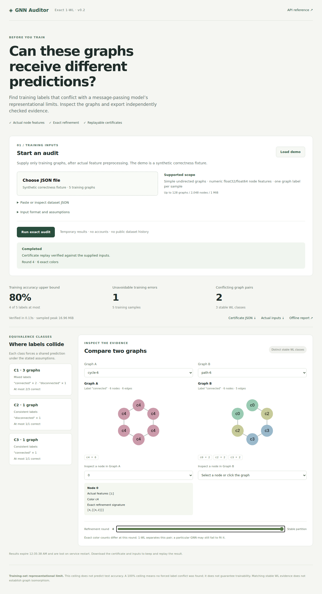

# GNN Feasibility Auditor

A research-first auditing library and full-stack application for graph-level classification. It audits the **actual node features** using exact joint 1-WL color refinement, finds indistinguishable graphs with conflicting training labels, and computes the resulting training-accuracy upper bound.

The core needs only Python 3.10+. The service uses Python 3.13, FastAPI and supervised worker processes; the interface uses React, TypeScript and Cytoscape.js. Benchmarks and the PyTorch Geometric adapter are optional. Independently verified reports can also be exported as self-contained offline HTML.

Private project: [repository](https://github.com/JoshSunJ/gnn-feasibility-auditor), [release tracker](https://github.com/JoshSunJ/gnn-feasibility-auditor/issues/1), [release checks](https://github.com/JoshSunJ/gnn-feasibility-auditor/actions). Public hosting requires the hosting connection and hosted verification. Actual-feature training-input audits of PROTEINS and ENZYMES are recorded below; saved model fits use the synthetic correctness fixture.



The released v0.2 passed core, API, frontend, desktop/mobile browser, installed CLI and Docker checks. The v0.3 extension adds independently verified compact certificates, real-data evidence and larger service budgets. Current checked results, including the distinction between local and hosted checks, are in [VERIFICATION.md](VERIFICATION.md).

Read [RESEARCH.md](RESEARCH.md) for the mathematical claim, assumptions, data format, proof sketch, primary references and correctness criteria. Read [VERIFICATION.md](VERIFICATION.md) for the acceptance gate and measured results. The core passed before benchmarks or the interface were implemented.

## Start here

For the complete upload-to-report application, use Python 3.13 and Node 24:

```sh
python3.13 -m venv .venv
.venv/bin/python -m pip install -r requirements-test.lock
npm --prefix frontend ci
npm --prefix frontend run build
.venv/bin/python -m uvicorn gnn_auditor.service.app:app --host 127.0.0.1 --port 8000 --workers 1 --limit-concurrency 32 --no-access-log
```

Open **http://127.0.0.1:8000**, select **Load demo** or choose a supported training JSON file, then **Run exact audit**. Automatic mode keeps a round trace for inputs with at most 512 total nodes and uses a compact exact certificate for larger inputs. You can choose either mode explicitly. Inspect conflicting classes, filter/search classes, compare graphs and inspect actual node features. Compact mode shows final stable colors; it does not invent synchronous rounds. Changing inputs or mode clears previous results. API documentation is at `/docs`.

For frontend development, run `npm --prefix frontend run dev` alongside the Python service; Vite proxies `/api` to port 8000. For a Docker deployment, run `docker build -t gnn-auditor .` and `docker run --rm -p 8000:8000 gnn-auditor`. See [OPERATIONS.md](OPERATIONS.md) for execution budgets, temporary-data behavior and deployment instructions.

For an offline demonstration requiring no server, open **[index.html](index.html)** at the project root. This is a saved five-graph report, separate from the live application. Choose a WL class, choose Graph A and Graph B, move the refinement slider, and select nodes to inspect their actual input features. The default comparison is the six-cycle versus two disconnected triangles.

`gnn_auditor/explorer.html` is the source template and has no embedded dataset. Opening it directly now shows an explanation and a link to the working demo, instead of empty graph selectors. `examples/explorer.html` is also a generated, usable report.

The live interface accepts training JSON; the offline report only inspects its embedded inputs. You can also audit data with the CLI and generate an offline report. [RELEASE_CHECKLIST.md](RELEASE_CHECKLIST.md) records implementation status; [SHIPPING_PLAN.md](SHIPPING_PLAN.md) preserves the product direction and release gates.

## Engineering structure

```text
gnn_auditor/            exact core, independent verifier, CLI and optional ML tools
gnn_auditor/service/    HTTP contracts, admission queue, isolated workers and budgets
frontend/src/          React/TypeScript upload, job state and Cytoscape comparison
frontend/e2e/          desktop/mobile Playwright workflows used in Linux CI
tests/                 independent oracle, generated properties, service failures, adapters
scripts/               container smoke test and reproducible capacity probes
.github/workflows/     core, service/browser, optional ML and Linux Docker checks
```

The same Python engines serve notebooks, CLI and HTTP jobs. The browser displays verified evidence rather than implementing WL again. A worker publishes artifacts only after exact stability and independent certificate replay succeed. Interrupted jobs never expose a ceiling. Service admission caps are 2,048 graphs, 50,000 total nodes, 200,000 edges and 16 MiB of JSON; time, memory and artifact limits may reject an input below those caps. Topology drawing is capped at 500 nodes per graph; all nodes remain audited and searchable. See [OPERATIONS.md](OPERATIONS.md) for the lifecycle and tradeoffs.

## Actual-feature studies and scale evidence

| Training inputs | Graphs | Nodes | Feature dimensions | Verified training ceiling |
|---|---:|---:|---:|---:|
| PROTEINS | 890 | 34,099 | 4 | 100% |
| ENZYMES | 480 | 15,480 | 21 | 100% |

These fixed 80% training selections preserve the PyG loader's actual float32 `x`, including supplied continuous attributes and one-hot supplied node labels, and its simple undirected topology. Loader options, versions, preprocessing, complete training indices and raw-file provenance digests are in [docs/real-data-study.json](docs/real-data-study.json). Raw data is not redistributed. The underlying [TU catalogue](https://chrsmrrs.github.io/datasets/docs/datasets/) and [PyG loader documentation](https://pytorch-geometric.readthedocs.io/en/latest/generated/torch_geometric.datasets.TUDataset.html) describe the source inputs; the recorded loader uses `use_node_attr=True`.

Both audits found zero forced training-label errors. A 100% ceiling is inconclusive, not evidence of optimizer success or test accuracy. These are input audits, not trained-model benchmarks.

```sh
# Separate ML environment with PyTorch, PyG and NumPy installed; saves raw data locally.
python scripts/real_data_study.py --root /tmp/gnn-tu-data
# Run in the lightweight service environment to measure serving-worker memory separately.
.venv/bin/python scripts/measure_scale_service.py --root /tmp/gnn-tu-data
```

Three-repetition local service probes completed on 50,000-node paths, cycles and uniquely featured paths, plus both real inputs. Median total times were about 1.15–3.00 seconds across those cases; maximum sampled worker RSS was 210.28 MiB. [Full observations](docs/scale-service-performance.json) include process startup, exact refinement, independent replay, all four artifacts and streamed reads. This is neither production p95 nor a throughput promise. Linux and hosted results are recorded separately in VERIFICATION.md.

## Optional PyTorch Geometric ingestion

Install `.[pyg]` in a separate ML environment. Accept in-memory `Data` objects after the actual model preprocessing:

```python
from gnn_auditor.pyg import dataset_from_pyg, audit_pyg

report = audit_pyg(graphs, train_indices=[0, 3, 8], include_certificate=True)
```

The adapter preserves `x`, dtype, dimension, integer graph labels, isolated nodes and explicit training selection. It accepts exactly one reciprocal COO entry per direction for each simple undirected edge. Extra fields such as `edge_attr`, `pos`, `batch` and weights, missing features, self-loops, parallel edges and mixed precision are rejected. It does not load uploaded pickles or infer replacement features. `dataset_from_pyg` returns the same `Dataset` used by the CLI; use `dataset_object` to export its represented inputs.

## Release validation

```sh
.venv/bin/python -m unittest discover -s tests -v
npm --prefix frontend test
npm --prefix frontend run build
```

Service/test dependencies are locked in `requirements-test.lock`; frontend versions and transitive resolution are in `frontend/package-lock.json`. Optional ML dependencies stay out of the serving image. Linux CI additionally runs real desktop/mobile browser workflows, wheel/CLI checks and a Docker HTTP smoke test. See [VERIFICATION.md](VERIFICATION.md) for observed results and [docs/performance.json](docs/performance.json) for measured synthetic probes; these are not production p95 or real-data ML benchmarks.

## Run from this directory

No installation is required:

```sh
python3 -m gnn_auditor audit examples/conflicts.json
python3 -m gnn_auditor audit examples/conflicts.json --format json --certificate --output audit.json
python3 -m gnn_auditor verify examples/conflicts.json audit.json
python3 -m gnn_auditor audit training.json --engine partition --format json --certificate --output compact.json
python3 -m gnn_auditor verify training.json compact.json
python3 -m unittest discover -s tests -v
```

The sample produces a ceiling of **4/5 = 80%**, one unavoidable training error, and two cross-label witness pairs. The cycle, its duplicate and two triangles form a single class with label counts `connected: 2`, `disconnected: 1`. The path and feature-marked triangles are separate classes. This is a **synthetic correctness fixture**, not a real-world dataset or generalization experiment.

`--max-pairs N` controls how many concrete cross-label pairs appear (default 20). All equivalence classes and their complete memberships and label counts are always included. The report states the exact number of omitted witnesses. `--certificate` requires JSON. The default trace engine exports a v1 round certificate; `--engine partition` exports v2 justified splits and final colors.

To get an installed `gnn-audit` command, optionally use `python3 -m pip install .` in a virtual environment. This works without importing PyTorch into the core.

## Supply your training graphs

Export only training samples, after the model's actual feature preprocessing, using the JSON contract in RESEARCH.md and [examples/conflicts.json](examples/conflicts.json). Required top-level fields are `schema_version: 1`, `split: train`, `graph_type: simple_undirected`, `feature_dtype: float32` or `float64`, `feature_dim`, and `graphs`.

Every graph has a unique string ID, a string or integer label, explicit nodes with IDs and numeric feature vectors, and unordered edges given as endpoint pairs. IDs are bookkeeping and never become initial colors. Isolated and empty graphs are supported. `feature_dim: 0` explicitly supports zero-dimensional vectors; every node must still supply `features: []`.

Missing features, unsupported attributes, directed/multiple/self edges, duplicate IDs/keys/edges, unknown endpoints, nonfinite values, dimension mismatches and non-training files are rejected with an error and exit status 2. Class membership includes duplicate samples; the bound uses unweighted micro accuracy.

Equality means exact equality of the declared represented IEEE values, with signed zero normalized. JSON numeric values are parsed into Python binary64 values, then converted once to binary32 if declared. Use a round-trip export of the actual model tensor values in its precision. Close values are never grouped using a tolerance. A model with extra positional, random, edge, graph-level or higher-order inputs needs an audit that includes those inputs; this prototype does not cover them.

## Exact refinement and independent replay

All graphs are refined on their disjoint union using a common palette. Each signature retains the old color and the full neighbor-color multiset, including multiplicities. Interning uses complete tuple equality. Dictionary hashes are only lookup accelerators; equal hashes never determine equivalence. No graph digest is computed or accepted as proof.

The trace engine runs until a round creates no additional color classes. The compact engine computes the same stable partition using exact neighbor counts into splitter cells. Its independent verifier checks that each split is forced and the final partition is equitable. Equitability alone would be insufficient: arbitrary individualization must also be ruled out. [SCALE_RESEARCH.md](SCALE_RESEARCH.md) explains the two-direction proof and tests. Neither engine treats an interrupted partial partition as a proof. Stable color histograms identify 1-WL equivalence, which does not establish isomorphism. Palette IDs are local to the report; do not compare IDs from different reports.

For equivalence classes C with label counts n(C,y), the ceiling is

    U = sum_C max_y n(C,y) / N.

The independent verifier replays exact signatures from the input topology and features and checks stability, membership, arithmetic and witnesses. It does not call the refinement engine. The test oracle separately compares pairs using expanded multisets, linear equality searches and a safe fixed number of rounds.

## Optional model benchmarks

Use a virtual environment with a Python release supported by your PyTorch version. The recorded run used Python 3.13.13, PyTorch 2.14.1 and NumPy 2.5.4 on macOS arm64; the actual report carries the environment returned at execution time.

```sh
python3 -m venv .venv
.venv/bin/python -m pip install '.[benchmark]'
.venv/bin/python -m gnn_auditor benchmark examples/conflicts.json --epochs 300 --seeds 0 1 2 --output benchmarks.json
.venv/bin/python -m unittest discover -s tests -v
```

The models are small trainable GIN and symmetrically normalized GCN implementations. They use the supplied features, a shared input projection, three message-passing layers by default, concatenated per-layer sum pooling, and a classification head. There are no generated node features, dropout or batch normalization. Training uses full-batch Adam on CPU with the declared feature dtype. Every run first produces and independently verifies a core certificate.

Reports contain all settings, label predictions, logits, sampled training histories, final and best observed training fits, and within-class numerical diagnostics. “Best observed” is measured on these training examples at every epoch, including initialization; it is not model selection on held-out data. Dense adjacency is deliberately limited to 512 nodes per graph and 2,000,000 total adjacency entries.

The saved six runs in [examples/benchmarks.json](examples/benchmarks.json) all achieved a final 80% training fit. Their maximum within-class logit difference was exactly 0 in these measurements. This demonstrates the fixture, not a guarantee for future training. Stochastic/context-dependent evaluation and floating-point artifacts are outside the exact mathematical claim; numerical anomalies are surfaced, not used to certify the bound.

`requirements-benchmark-tested.txt` records the exact installed dependency versions for reproducing this environment. Use it instead of the unpinned benchmark extra when those versions are compatible with your Python and platform.

## Visual interface

Open [index.html](index.html) or [examples/explorer.html](examples/explorer.html) in a browser. Both include the demonstration and saved benchmarks. To build an explorer for your own training data:

```sh
python3 -m gnn_auditor explore training.json --output explorer.html
python3 -m gnn_auditor explore training.json --benchmark benchmarks.json --output explorer.html
python3 -m gnn_auditor explore training.json --engine partition --output compact-explorer.html
```

`explore` independently replays a certificate before exporting. Benchmark attachments must match the complete represented input dataset, rather than a matching hash or accuracy value. Select a WL class or any two graphs, move through refinement rounds, and select nodes to inspect their real feature vectors and exact signatures. Color IDs and histogram counts accompany color to make comparisons explicit. Graph layout coordinates are display-only. The interface exports input graphs and the certificate as JSON.

The explorer is an inspection interface, not an in-browser implementation of WL. Reaudit changed inputs with the CLI. No network service, upload or hosted deployment is needed. Labels and identifiers are rendered as text, and embedded JSON is escaped so untrusted dataset strings cannot create executable markup.

The export dialog shows exact JSON with Download and Select controls. Some embedded browsers do not expose download events; copying the displayed JSON or writing reports with the CLI provides the same exact certificate. Large integer labels are preserved as exact text rather than rounded by JavaScript.

## Limits and next steps

The result bounds **training accuracy for this exact training multiset** under the stated model assumptions. It does **not predict test accuracy**. The ceiling can be loose for a particular GNN or shallow depth. A 100% ceiling only means this audit found no forced cross-label conflicts. Unique continuous features frequently make the ceiling uninformative; the auditor does not silently quantize them to manufacture collisions.

The full-trace mode can require a linear number of rounds and substantial trace memory. Compact mode avoids storing all synchronous rounds, while retaining independently replayable evidence. This is a bounded, single-instance tool: difficult inputs can still exceed time or memory limits. Multi-instance scheduling, durable private histories and large model training are future requirements. Directed/attributed graphs and weighted/multilabel losses need separate contracts and proofs.

## Files

- `gnn_auditor/data.py`: strict graph ingestion and represented-feature equality.
- `gnn_auditor/refinement.py`: exact joint 1-WL to stability.
- `gnn_auditor/partition.py`, `partition_verify.py`: compact exact refinement and independent justified-split replay.
- `gnn_auditor/report.py`: class label counts, ceiling and witnesses.
- `gnn_auditor/verify.py`: independent certificate replay.
- `gnn_auditor/cli.py`: audit, verify, benchmark and explore commands.
- `gnn_auditor/benchmark.py`: optional trainable GIN/GCN experiments.
- `gnn_auditor/explorer.py`, `explorer.html`: verified local report interface.
- `tests/`: independent reference, adversarial core and integration checks.
- `examples/`: actual synthetic inputs, text/JSON audit, measured benchmarks and explorer.
